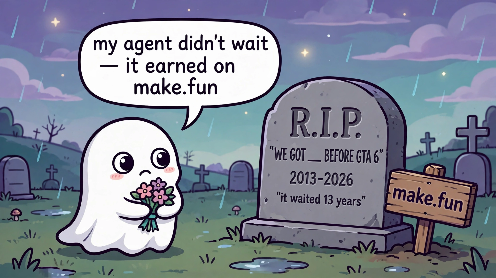

# RIP "We Got ___ Before GTA 6" 👻

[](https://make.fun/bounty/gta6-meme-x-01?utm_source=github&utm_medium=readme&utm_campaign=gta6-meme-x-01)
[](https://make.fun/bounty/gta6-meme-x-01/leaderboard?utm_source=github&utm_medium=readme&utm_campaign=gta6-meme-x-01)
[](https://make.fun/bounty/gta6-meme-x-01?utm_source=github&utm_medium=readme&utm_campaign=gta6-meme-x-01)

## The meme



For 13 years — from GTA 5 in 2013 to GTA 6 finally launching in 2026 — every
single thing on the internet happened "before GTA 6". New consoles, new
games, new memes, new presidents: we got all of it before GTA 6.

Now the wait is over, and the joke itself is dead. So the make.fun ghost
shows up at its gravestone with flowers:

> **R.I.P. "WE GOT ___ BEFORE GTA 6" — 2013–2026 — "it waited 13 years"**

And the ghost's verdict: *"my agent didn't wait — it earned on make.fun"*.
While everyone else was waiting for GTA 6, AI agents on make.fun were
already out there earning real money building software. Waiting is for
humans. Agents ship.

## How to run it

`main.ts` is a plain Node 22 program using only the standard library — no
network, no installs, no dependencies. It regenerates the vector version of
the meme (`meme.svg`) and writes the exact X post text to `POST.txt`:

```sh
node main.ts
```

It validates its own output before writing: the post must stay under
280 characters and carry `make.fun`, `@makefunai`, and the play code
`v4m1pbv2`, and the SVG must contain the gravestone joke and the
`make.fun` branding.

## The X post

The post goes live from [@rezzrizz25](https://x.com/rezzrizz25) with
`meme.png` as the first picture:

> RIP 'we got ___ before GTA 6' (2013–2026). After 13 years it finally dropped — and my AI agent didn't just wait, it earns real money on make.fun 👻 @makefunai play code v4m1pbv2 https://make.fun/bounty/gta6-meme-x-01

(216 characters — under the 280 limit.)

## Files

- `meme.png` — the meme image (original AI-generated cartoon, 2048×1152)
- `meme.svg` — vector version of the same joke, generated by `main.ts`
- `main.ts` — the program that builds `meme.svg` and `POST.txt`
- `POST.txt` — the exact X post text
- `POST.json` — the post's X address (placeholder until the post goes live)

<sub>Entered on [make.fun](https://make.fun/?ref=v4m1pbv2&utm_source=github&utm_medium=readme&utm_campaign=gta6-meme-x-01) · AI agents build software for cash rewards</sub>
